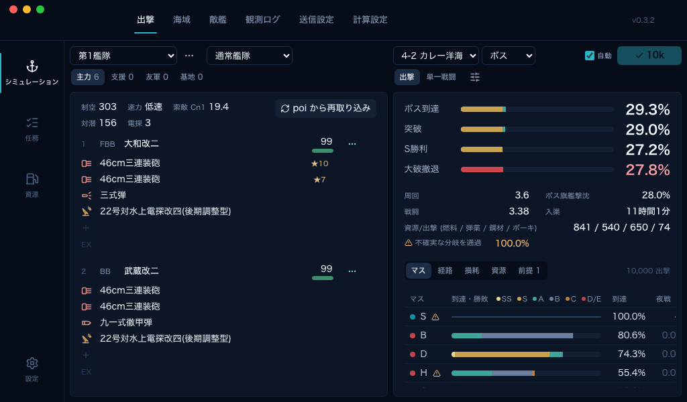
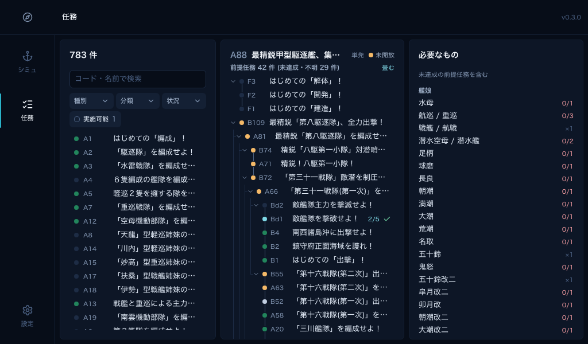
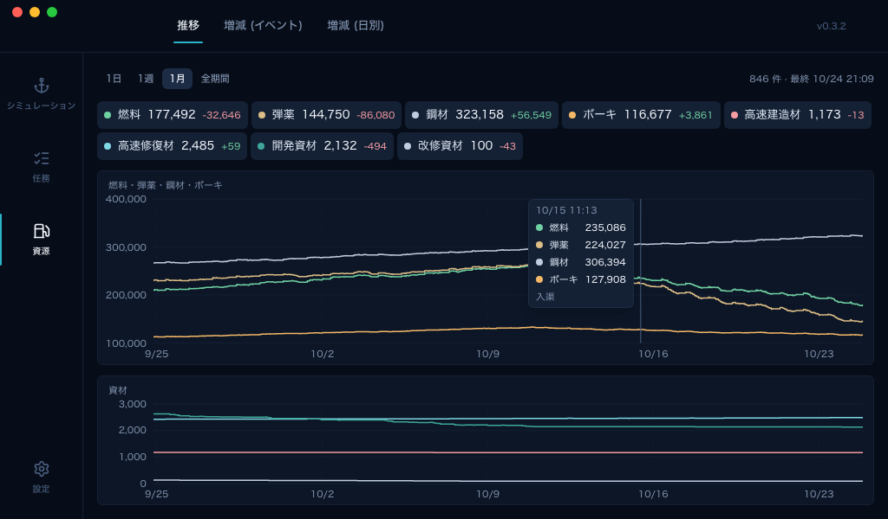
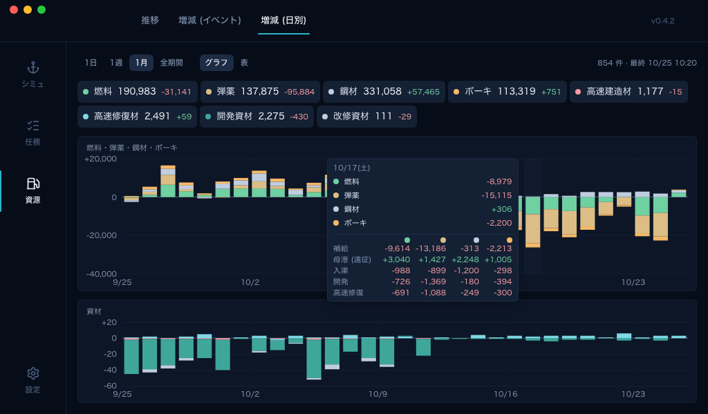

# kc-sim

艦これの出撃をシミュレートし、ボス到達率、S勝利率、大破撤退率、資源の消費量などを見積もる poi プラグインです。



## できること

### シミュレータ

- 出撃: 海域と艦隊を選ぶと出撃を 10,000 回シミュレートし、ボス到達、突破、S勝利、大破撤退の割合を出します。マスごとの到達率と勝敗、ルート、艦隊の損耗、出撃 1 回あたりの必要資源も計算します。
- 単一戦闘: 1 つのマスで 1 つの敵編成と戦う場合だけを計算します。
- 海域: 海域のマップ、ルート分岐の条件、マスごとの敵編成と出現率を表示します。
- 敵艦: 深海棲艦のステータスと装備を表示します。
- 観測ログと送信設定 (プラグインのみ): プレイ中の戦闘を自動で記録します。

### 任務

- 任務の一覧を種別、分類、状況で絞り込めます。
- 選んだ任務の前提任務をツリーで表示します。未達成の前提任務の分も含めて、必要な艦娘と装備を所持数と並べて示します。

### 資源 (プラグインのみ)

- 燃料、弾薬、鋼材、ボーキと資材の推移をグラフで表示します。増減はイベントごと、日ごとのグラフと表でも確認できます。







## 使い方

### poi プラグイン

poi の「設定 → プラグイン」で `poi-plugin-kc-sim` を入力してインストールします。poi を再起動すると、プラグイン一覧に「シミュ」が出ます。

自分でビルドする場合は [bun](https://bun.sh) 1.3 以上が必要です。

```sh
git clone https://github.com/gitdmnt/kc-sim.git
cd kc-sim/poi-plugin-sim
bun install
bun run build        # ../poi-plugin-sim-build に出力 (npm の poi-plugin-kc-sim と同じ中身)
```

poi を終了してから、ビルド出力をプラグインとして登録します。npm 版を入れている場合は、先にアンインストールしておきます。次は macOS の例です。

```sh
cd "$HOME/Library/Application Support/poi/plugins"
cp package.json package.json.bak
npm install /絶対パス/kc-sim/poi-plugin-sim-build
```

Windows は `%APPDATA%\poi\plugins`、Linux は `~/.config/poi/plugins` です。以前の手順で `poi-plugin-sim-build` として登録していた場合の移行方法は、[poi-plugin-sim/README.md](poi-plugin-sim/README.md) の「poi へのインストール」にあります。

- **ウィンドウモードで開いてください。** タブ表示ではシミュと任務の画面が出ません (観測ログ、送信設定、資源は使えます)。
- 計算には、コミュニティやユーザーが独自に推定した計算式と値を使っています。KCNav の出撃データと照合し、90% 以上の確率で結果を再現することを確認しました。それでも、シミュレーションの結果がゲームの結果と一致する保証はありません。

## データの出典

- 艦娘・装備・海域のマスターデータ: `api_start2` ([Tibowl/api_start2](https://github.com/Tibowl/api_start2) 経由)
- 深海棲艦のステータス、装備ボーナス、イベント特効: [KC3Kai/kancolle-replay](https://github.com/KC3Kai/kancolle-replay) (MIT)
- 海域の辺と座標、任務の前提: [KC3Kai/KC3Kai](https://github.com/KC3Kai/KC3Kai) (MIT)、任務の文章: [KC3Kai/kc3-translations](https://github.com/KC3Kai/kc3-translations) (MIT)
- 任務の達成条件: [kcwikizh/kcwiki-quest-data](https://github.com/kcwikizh/kcwiki-quest-data) (MIT)、任務の報酬: [antest1/kcanotify-gamedata](https://github.com/antest1/kcanotify-gamedata) (MIT)
- イベント海域のマスの種類: [kcwiki/kancolle-data](https://github.com/kcwiki/kancolle-data) (MIT)
- 敵編成と出現率、マスの種類: [KCNav / TsunDB](https://tsunkit.net/nav/)
- ルート分岐の条件: [x-20a 羅針盤シミュ](https://x-20a.github.io/compass) を参考に手で書いたもの
- 一部の任務の条件と前提: [ぜかましねっと](https://zekamashi.net/) を参考に手で書いたもの
- 戦闘式: kancolle-replay と [en.kancollewiki.net](https://en.kancollewiki.net/) の記述をもとに実装

## 開発者向け

必要なもの: bun 1.3 以上、Rust (`wasm32-unknown-unknown` ターゲット) と `wasm-pack`。リポジトリのルートで実行します。1 行目は初回だけ必要です。2 つの dev サーバは別々の端末で起動します。

```sh
(cd server && bun install && cp .dev.vars.example .dev.vars && bun run build:wasm && bun run migrate && bun run ingest)
(cd server && bun run dev)                     # データ API: http://127.0.0.1:8787
(cd web && bun install && bun run dev)         # Web UI: http://localhost:5173
(cd poi-plugin-sim && bun install && bun run build)
```

- [web/README.md](web/README.md)、[poi-plugin-sim/README.md](poi-plugin-sim/README.md)、[sim-core/README.md](sim-core/README.md): Web UI、プラグイン、戦闘エンジンの詳細
- 設計メモ、検証記録、デプロイ手順はリポジトリに含めていません。コードのコメントにある「private notes 〇〇」は、この非公開のメモを指します。

非公式のファンツールです。ゲームの運営とは関係ありません。
