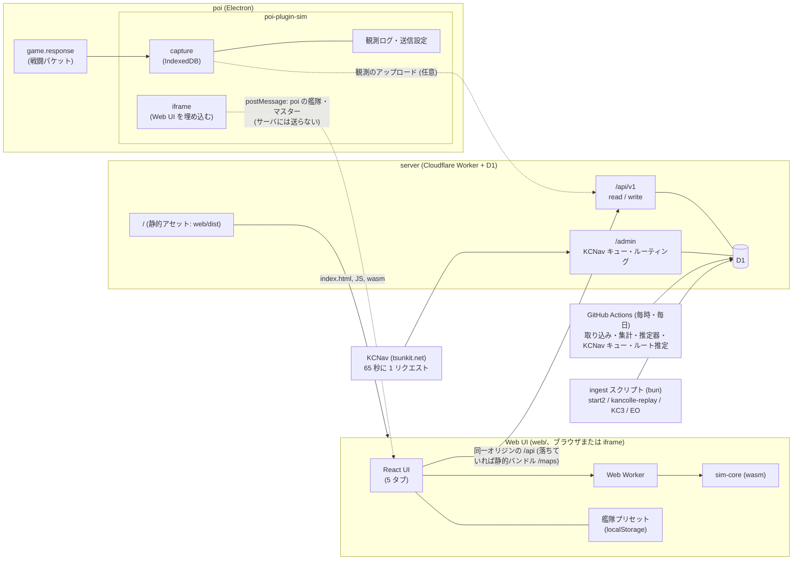

# kc-sim — 艦これ 出撃シミュレータ (Web UI + poi プラグイン)

艦隊編成から海域のルーティング・敵編成・戦闘までを **モンテカルロ法で何千回も回し**、
「ボスに到達する確率」「S勝利率」「大破撤退率」「クリアまでの出撃回数」などを見積もるシミュレータです。
UI は Web アプリ (データ API と同じ Cloudflare Worker が配る) で、[poi](https://github.com/poooi/poi) 用プラグインが
それを埋め込み、poi の艦隊・マスターデータを渡します。計算はブラウザ内 (Web Worker + wasm) で行います。

> **状態:** 開発中。計算モデルは近似であり、ゲーム内の結果を保証しません。
> 前提と限界は [既知の制限](#既知の制限) を必ず読んでください。

## 機能 (4 本柱)

| 柱 | 内容 | 場所 |
|---|---|---|
| **1. 戦闘・出撃エンジン** | 砲撃・雷撃・対潜・航空戦・夜戦・命中/回避/クリティカル/装甲・陣形・交戦形態・轟沈ストッパー、ルーティング評価、撤退ポリシー、ゲージ。Rust → wasm、シード指定で完全再現可能 | `sim-core/` |
| **2. データ基盤** | マスターデータ、深海棲艦の表示/隠しステータス (出典付き)、海域グラフ、ルーティング規則 (自作 DSL)、敵編成と出現率 (KCNav)、装備ボーナス。ローカル完結の HTTP API と静的バンドル | `server/` |
| **3. 観測と推定** | poi の通信から戦闘を自動記録 (IndexedDB) してサーバに送信。サーバが敵の回避・命中・運をベイズ推定し、シミュレーションに反映 | `poi-plugin-sim/src/capture`, `shared/estimate`, `server/src/estimator` |
| **4. UI** | Web UI: 出撃 (海域選択・艦隊編成・結果を 1 画面に置き、編成を変えるたびに自動で再計算。出撃 / 単一マス戦闘) / 海域 / 敵艦 / 推定 / 設定。poi プラグイン: Web UI の埋め込み + 観測ログ / 送信設定。Web Worker で計算 | `web/`, `poi-plugin-sim/` |

スクリーンショットは [`docs/screenshots/`](docs/screenshots/) にあります (`13-poi-plugin-window`・`14-poi-plugin-sim`・`16-poi-sortie` は
実機の poi で撮ったもので、UI を Web に移す前の旧プラグイン UI です。埋め込みの見え方は開発用ページで撮った `19-plugin-embedded`。
艦隊編成・シミュレーションの画像は出撃タブに統合する前のもので、`cd web && bun run screenshots` で撮り直せます)。

## アーキテクチャ



詳細は [docs/ARCHITECTURE.md](docs/ARCHITECTURE.md)。

## リポジトリ構成

単一の git リポジトリ (モノレポ) です。各サブプロジェクトは兄弟ディレクトリを相対パスで参照するため、
このレイアウトのまま使ってください (`poi-plugin-sim` と `sim-core` は旧個別リポジトリの履歴をサブディレクトリ配下に保持しています)。

| ディレクトリ | 内容 | 兄弟への参照 |
|---|---|---|
| `sim-core/` | Rust → wasm のシミュレーションエンジン | テストが `../server/seed/routing` を読む |
| `server/` | Cloudflare Worker + D1 (データ API、KCNav クローラ、推定器)。`web/dist` を静的アセットとして配る | `wrangler.toml` の `[assets]` が `../web/dist` |
| `web/` | Web UI (React、vite)。シミュレーションはブラウザ内の Web Worker + wasm | `vite.config.ts` が `../sim-core` (wasm-pack) と `../server/dist/maps` を使い、`web/dist` に出力 |
| `poi-plugin-sim/` | poi プラグイン (キャプチャ・送信・観測ログ、Web UI の埋め込み) | `@web/*` で `../web/src` の UI 部品を使い、`../poi-plugin-sim-build` に出力 |
| `shared/` | プラグイン・Web UI・Worker が共有する TypeScript (パーサ、編成、推定、埋め込みのプロトコル) | — |
| `docs/` | 設計・API・検証ドキュメント | — |

ローカル専用のもの (`server/.wrangler` の D1、`.dev.vars`、`web/myState.json`、ビルド出力) は `.gitignore` 済みです。

## クイックスタート

必要なもの: [bun](https://bun.sh) ≥ 1.3、Node ≥ 20、Rust (`wasm32-unknown-unknown` ターゲット) と `wasm-pack`、poi。

```sh
rustup target add wasm32-unknown-unknown
cargo install wasm-pack
```

### 1. データ基盤を起動する

```sh
cd server
bun install
cp .dev.vars.example .dev.vars          # ENVIRONMENT=development (localhost の /admin/* は認証なし) と IP_HASH_SALT
bun run build:wasm                      # sim-core/pkg (推定器が wasm を読み込む)
bun run migrate                         # D1 (ローカル) のスキーマ作成
bun run ingest                          # start2・深海棲艦・海域グラフ・装備ボーナス・ルーティング種
bun run dev                             # http://127.0.0.1:8787 で起動
curl -s http://127.0.0.1:8787/api/v1/health
```

`bun run ingest` のあとで `GET /api/v1/maps` が全海域を返せば成功です。
`GITHUB_TOKEN` を設定すると GitHub API のレート制限を避けられます。

### 2. 敵編成を取得する (KCNav クローラ)

敵編成と出現率は KCNav (tsunkit.net) の公開データです。**サーバ側で 65 秒に 1 リクエストに制限**され
(ゲートは D1 に保存され、再起動しても守られます)、ワーカーが起動している必要があります。

```sh
bun run kcnav enqueue --maps 1-5 --kinds map                   # ノード種別・座標
bun run kcnav enqueue --maps 1-5 --kinds enemycomps --batch    # 敵編成 (1 マップ 1 リクエスト)
bun run kcnav:run                                              # 常駐の取得ループ
bun run kcnav:status                                           # 進捗・ETA・失敗
```

> **KCNav の一括取得は、運営者の許可なく行わないでください** ([docs/DATA_SOURCES.md](docs/DATA_SOURCES.md) の §1 と §10)。

### 3. Web UI を動かす

```sh
cd web
bun install
bun run dev           # http://localhost:5173 (/api は 127.0.0.1:8787 に中継。変更は HMR で反映)
```

poi なしのブラウザでは poi のデータが無いので、設定タブの「内蔵サンプルデータを使う」で同梱の艦・装備を使えます
(開発サーバでは `web/myState.json` (poi の state のダンプ) か同梱サンプルを poi の代わりに読みます)。
データ API と同じ Worker から配る形は `cd web && bun run build` → `cd server && bun run dev` → http://127.0.0.1:8787/ 。

### 4. プラグインをビルドして poi に入れる

```sh
cd poi-plugin-sim
bun install
bun run build         # 先に ../web の依存を入れ (prebuild: bun install --frozen-lockfile)、vite → ../poi-plugin-sim-build (wasm は含まない)
```

poi のプラグインディレクトリにビルド出力をリンクします (macOS の例。他 OS は [poi-plugin-sim/README.md](poi-plugin-sim/README.md))。

```sh
cd "$HOME/Library/Application Support/poi/plugins"
cp package.json package.json.bak
npm pkg set dependencies.poi-plugin-sim-build="file:/絶対パス/kc-sim/poi-plugin-sim-build"
ln -s /絶対パス/kc-sim/poi-plugin-sim-build node_modules/poi-plugin-sim-build   # 作られなければ
```

poi を再起動すると、プラグイン一覧に「シミュ」が現れます。**ウィンドウモードで開いてください** (タブ表示では Web UI を埋め込みません)。
サーバ URL (既定 `https://kc-sim.udama.net/`) は送信設定 (プラグインのヘッダ) で変更できます。手元のサーバなら `http://127.0.0.1:8787/`。

### テスト

```sh
(cd sim-core && cargo test)
(cd server && bun test)
(cd shared && bun test)
(cd web && bun test && bun run typecheck)
(cd poi-plugin-sim && bun test && bunx tsc --noEmit)
```

## データの更新手順

| 更新したいもの | 手順 |
|---|---|
| マスターデータ・深海棲艦・装備ボーナス・海域グラフ | `cd server && bun run ingest` (個別: `ingest:start2` / `ingest:abyssal` / `ingest:graph` / `ingest:fit`)。新しいリビジョンがあれば取り込み、出典は `GET /api/v1/sources` に残る |
| 敵編成 (海域の改修・イベント) | `bun run kcnav enqueue --maps <海域> --kinds enemycomps --batch --start <変更日> --refresh` のあと `kcnav:run`。海域のレイアウトが変わったら先に `--kinds map` |
| ルーティング規則 | `server/seed/routing/{W-M}.json` を編集 → `bun test` (検証) → `bun run ingest:routing`。確認できない条件には `uncertain: true` を付ける ([docs/ROUTING_DSL.md](docs/ROUTING_DSL.md)) |
| ルーティングの妥当性確認 | `bun run kcnav enqueue --kinds nodesummary …` → `bun run validate:routing` ([docs/VALIDATION.md](docs/VALIDATION.md)) |
| オフライン用の静的バンドル | `bun run export:bundle` (本番の D1 から作るなら `D1_REMOTE=1`) → `server/dist/maps/*.json`。Web UI のビルドが `web/dist/maps` に同梱し、Worker の静的アセットとして配る |
| Web UI | `cd server && bun run deploy` (`web/` をビルドしてから Worker ごとデプロイ、[docs/DEPLOY.md](docs/DEPLOY.md)) |
| プラグイン | `cd poi-plugin-sim && bun run build` (poi を再起動) |

## ライセンスと出典・許可について

- **コード:** `web` と `poi-plugin-sim` は MIT (`poi-plugin-sim/LICENSE`。`web/` は旧プラグインの UI を移したもの)、`sim-core` は MIT OR Apache-2.0。
- **戦闘式** は KC3Kai / kancolle-replay (MIT, © 2016 fourinone41) の `kcsim.js`・`kcships.js` と
  en.kancollewiki.net の記述を参考に移植・検証しています。
- **データの出典・ライセンス・許可の状況** は [docs/DATA_SOURCES.md §10](docs/DATA_SOURCES.md#10-licence--permission-status-of-shipped-data) に表でまとめています。要点:
  - **ライセンス不明のデータを同梱・公開する前に、作者への確認が必要です。**
    ルーティング規則 (x-20a 羅針盤シミュ由来、手作業で翻訳)、敵編成と出現率 (KCNav / TsunDB)、
    装備ボーナス (ElectronicObserver のデータ) が該当します。
  - マスターデータはゲーム自体のデータで、他のビューア系ツールと同様の扱いです。
  - MIT のもの (kancolle-replay の深海棲艦ステータス、KC3Kai の辺・座標) は帰属表示で足ります。
- KCNav (@pir0zhki) には、一括取得・集計の再配布について必ず先に相談してください。
- ユーザーの観測データのアップロードは任意で、再配布には本人の同意が必要です。
- 本プロジェクトは非公式のファンツールで、ゲームの運営会社とは無関係です。

## 既知の制限

- **モデル範囲:** 通常艦隊 1 つ対 1 ノード。連合艦隊・基地航空隊・支援・友軍艦隊・噴式強襲・空襲の一部・特殊攻撃の多く・
  イベント特効などは未対応。出撃シミュレーションでも資源/渦潮などのノード効果は未モデル。
  一覧は [docs/SIM_INTERFACE.md](docs/SIM_INTERFACE.md) の "Known simplifications" と "Sortie simplifications"。
- **敵の隠しステータス** (回避・対潜・索敵・運・命中) は公開されていません。データマイニング由来の値や
  推定値を使い、信頼度が低いもの (仮値・不明) は結果画面の「前提・信頼性」に表示されます。
- **推定の限界:** 運はほぼ識別できず、回避が高いと区間が広がり、モデルにない機構はすべて推定値に吸収されます。
  詳細は [docs/ESTIMATOR.md](docs/ESTIMATOR.md) の "Model limits"。
- **ルーティング:** 一部の規則は確認できていません (`uncertain`)。経路がそれを通る場合、結果画面に警告が出ます。
  KCNav の統計との照合結果は [docs/VALIDATION.md](docs/VALIDATION.md)。
- **装備ボーナス** は近似計算で、未対応の条件があります (`shared/sim/fit.ts`)。
- **戦闘結果の現実性:** 公開されている数式・数値との一致は確認していますが、戦闘全体の結果分布を実測と照合したものではありません。
- **poi 上の制約:** プラグインは Web UI を iframe で埋め込みます。poi のメインウィンドウは iframe にも Node.js を有効にする設定のため、
  **ウィンドウモードでのみ** 埋め込みます (タブ表示では案内を出すだけ。観測ログ・送信設定は使えます)。詳しくは [poi-plugin-sim/README.md](poi-plugin-sim/README.md)。
- ゲームにログインした状態での動作は、実機の poi では未確認です (未ログイン状態と合成データで確認)。

## ドキュメント

| 文書 | 内容 |
|---|---|
| [docs/ARCHITECTURE.md](docs/ARCHITECTURE.md) | 構成要素とデータの流れ |
| [docs/WORKFLOW.md](docs/WORKFLOW.md) | 開発の進め方、ローカル実行、KCNav の運用 |
| [docs/API.md](docs/API.md) | データ API (読み取り・書き込み・管理) と静的バンドル |
| [docs/ROUTING_DSL.md](docs/ROUTING_DSL.md) | ルーティング規則 DSL |
| [docs/SIM_INTERFACE.md](docs/SIM_INTERFACE.md) | sim-core の入出力契約・戦闘式・簡略化 |
| [docs/ESTIMATOR.md](docs/ESTIMATOR.md) | 隠しステータス推定の方法と限界 |
| [docs/VALIDATION.md](docs/VALIDATION.md) | 戦闘式・ルーティングの検証結果 |
| [docs/DATA_SOURCES.md](docs/DATA_SOURCES.md) | データの出典・ライセンス・許可の状況 |
| [docs/SURVEY.md](docs/SURVEY.md) | 初期の調査メモ (履歴) |
| [web/README.md](web/README.md) | Web UI の構成・開発サーバ・ビルド |
| [poi-plugin-sim/README.md](poi-plugin-sim/README.md) | プラグインのビルド・インストール・埋め込みのプロトコル・poi 上の注意 |
